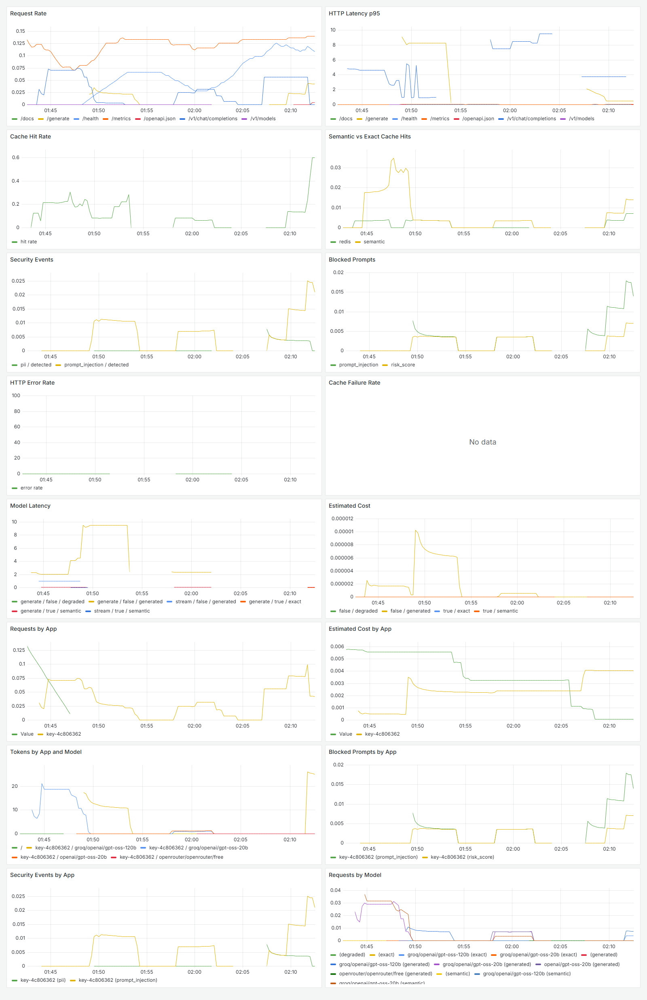
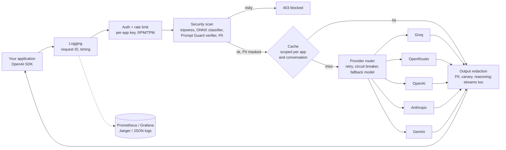
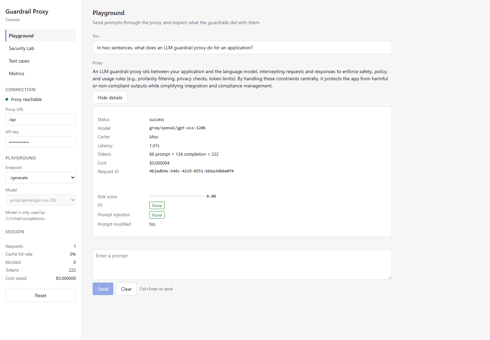
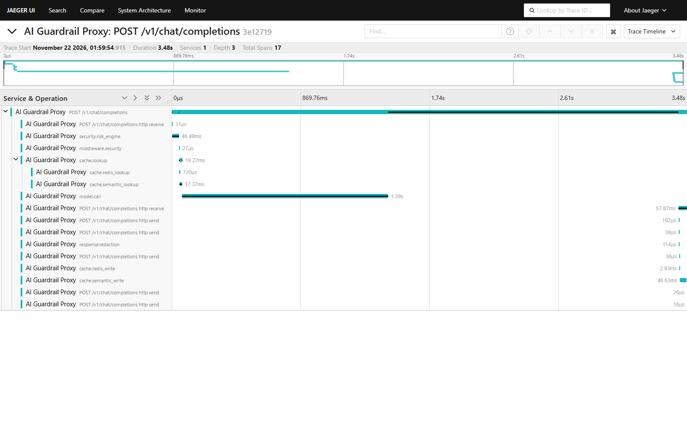
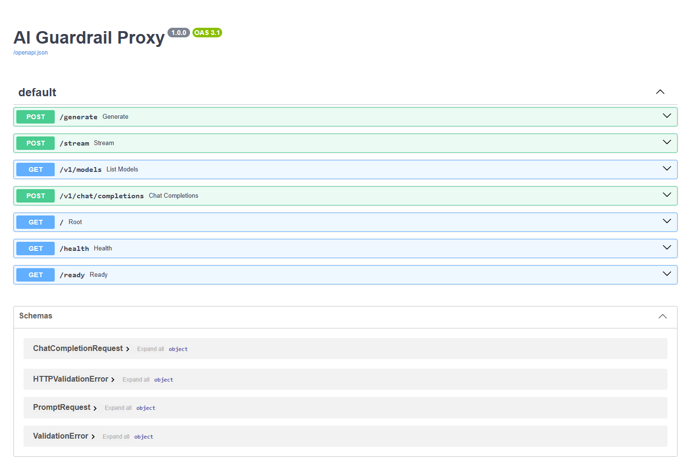

# AI Guardrail Proxy

**A security and observability gateway for LLM applications.** Point any app that uses an OpenAI SDK at the proxy, and every request is authenticated, rate-limited, scanned for prompt injection and personal data, cached, routed to the right model provider, redacted on the way back, and recorded in metrics, logs and traces. The app itself only changes two settings: `base_url` and `api_key`.



---

## Contents

- [Why it exists](#why-it-exists)
- [Features](#features)
- [How a request flows](#how-a-request-flows)
- [Screenshot tour](#screenshot-tour)
- [Quick start](#quick-start)
- [Connect your application](#connect-your-application)
- [Per-app keys and policies](#per-app-keys-and-policies)
- [Providers and models](#providers-and-models)
- [Security model](#security-model)
- [Observability](#observability)
- [API reference](#api-reference)
- [Configuration](#configuration)
- [Local development and tests](#local-development-and-tests)
- [Docker image](#docker-image)
- [Load test results](#load-test-results)
- [Repository structure](#repository-structure)
- [Limitations and roadmap](#limitations-and-roadmap)

---

## Why it exists

Every team that adds an LLM to an application ends up rebuilding the same protections: API keys, prompt-injection checks, PII handling, cost limits, caching, retries and dashboards. This proxy puts them in one place, in front of all your LLM traffic:

- **Security:** block jailbreaks and injections (including ones hidden in tool results), mask personal data before it reaches a model provider, and redact it from responses.
- **Isolation:** each application has its own key, limits, allowed models and cache; one app's data is never served to another.
- **Cost control:** exact and semantic caching, per-app token budgets, and a free-only guard for OpenRouter.
- **Reliability:** timeouts, retries, circuit breakers, fallback models, and clear HTTP status codes when something fails.
- **Visibility:** Prometheus metrics, a Grafana dashboard with per-app panels, OpenTelemetry traces in Jaeger, and JSON logs tagged with app and request ID.

## Features

| Area | What the proxy does |
|---|---|
| **OpenAI-compatible API** | `POST /v1/chat/completions` (streaming and non-streaming), `GET /v1/models`; tools/function calling, `response_format`, `max_tokens`, `temperature` and other parameters are forwarded |
| **Authentication** | One key per app, sent as `Authorization: Bearer` (what the SDKs send) or `x-api-key` |
| **Rate limiting** | Requests-per-minute and tokens-per-minute per key, enforced atomically in Redis (Lua); `429` with `Retry-After` |
| **Prompt injection** | Regex tripwires + structural delimiter checks + local ONNX DeBERTa classifier + Llama Prompt Guard 2 second opinion; scans user messages **and tool/function results** |
| **PII protection** | Presidio + regex detection of emails, phones, SSNs, cards, IPs, API keys, Aadhaar/PAN, ...; values are masked (`[EMAIL]`, `[API_KEY]`) before the model sees them |
| **Output hardening** | PII and system-prompt canary redaction on every response, **including streams**; model chain-of-thought (`reasoning`) is stripped |
| **Caching** | Redis exact cache + ChromaDB semantic cache (persistent, with TTL), scoped per app, system prompt, conversation and parameters |
| **Providers** | Groq, OpenAI, Anthropic, Gemini, and OpenRouter (free models only by default) behind one model naming scheme |
| **Resilience** | Timeouts, retries with backoff, per-model circuit breaker, fallback model, `503` + `Retry-After` when all models are down; provider `4xx` errors are passed through |
| **Observability** | Prometheus metrics labelled by app and model, a 16-panel Grafana dashboard, alert rules, Jaeger traces, JSON logs with tracebacks |
| **Web console** | React app to try prompts, watch the guardrails work and read live metrics |

## How a request flows



1. **Logging middleware** assigns a request ID and records timing and status for every request.
2. **Auth middleware** checks the app's key, identifies the app, and reserves the request against its RPM/TPM budget. Unauthenticated requests are rejected before any expensive scanning runs.
3. **Security middleware** scores each untrusted message on its own (user messages and tool results; the app's system prompt is trusted):
   - regex tripwires for known attack phrases and chat-delimiter tricks;
   - a local ONNX classifier (`protectai/deberta-v3-base-prompt-injection-v2`);
   - when the classifier is the *only* signal, **Llama Prompt Guard 2** (via Groq) is asked for a second opinion, so harmless command-style prompts aren't blocked;
   - PII detection; detected values are masked before the prompt goes anywhere.
4. **Cache:** an identical request from the same app and conversation is answered from Redis; a paraphrase in the same context from ChromaDB (`bge-small-en-v1.5` embeddings, ONNX).
5. **Provider router** sends the request to the chosen model with retries and a circuit breaker; on outages it falls back to `SECONDARY_MODEL_NAME`.
6. **Output redaction** masks PII and the system-prompt canary in the answer. Streams are redacted sentence by sentence before they are sent.
7. Metrics, logs and traces record the app, model, cache result, cost and security decisions.

## Screenshot tour

All screenshots were taken from the running Docker Compose stack.

### Playground: a request and what the guardrails did

Each answer shows the model used, cache result, latency, tokens, cost, risk score and the PII / injection checks.



### Security Lab: personal data is masked before it reaches the model

The original prompt contains an email address, a phone number and an API key. The model receives `[EMAIL]`, `[PHONE]` and `[API_KEY]` instead and still answers the request.


### Attacks are blocked

Instruction overrides, chat-delimiter injection and system-prompt extraction attempts are stopped with `403` before reaching any model.


### Semantic cache: a paraphrase is answered from cache

A reworded question is served from ChromaDB in milliseconds at zero model cost; the saved cost is reported.


### Live metrics in the console


### Grafana: traffic, latency, cache, security and cost, per app and model

The dashboard (shown at the top of this page) is provisioned automatically. The bottom rows break requests, cost, tokens, blocks and security events down **by application** and **by model**.

### Jaeger: one request traced through the proxy

Security scan, cache lookups, the model call, response redaction and cache writes appear as spans of a single trace.



### API documentation

FastAPI's interactive docs are served at `/docs`.



## Quick start

**Requirements:** Docker Desktop, and at least a [Groq](https://console.groq.com) API key (free tier works).

1. Create a `.env` file in the project root (minimal example; see [Configuration](#configuration) for everything else):

   ```env
   GROQ_API_KEY=your_groq_key
   API_KEYS=my-app:choose-a-long-random-proxy-key
   REDIS_URL=redis://redis:6379/0
   OTEL_EXPORTER_OTLP_TRACES_ENDPOINT=http://otel-collector:4318/v1/traces
   # Optional providers
   # OPEN_ROUTER_API_KEY=sk-or-...
   # OPENAI_API_KEY=...
   # ANTHROPIC_API_KEY=...
   # GEMINI_API_KEY=...
   ```

   Write each line as `NAME=value`, with no spaces around `=`; Docker rejects them.

2. Start the stack:

   ```bash
   docker compose -f docker-compose.observability.yml up -d --build
   ```

3. Wait until the models have loaded (about 10 seconds after the first download, which is ~780 MB and is cached in a volume):

   ```bash
   curl http://localhost:8000/health
   ```

| Service | URL |
|---|---|
| Proxy API | http://localhost:8000 (docs at `/docs`) |
| Web console | http://localhost:5173 |
| Grafana | http://localhost:3000 (`admin` / `admin`) |
| Prometheus | http://localhost:9090 |
| Jaeger | http://localhost:16686 |

## Connect your application

### Python (OpenAI SDK)

```python
from openai import OpenAI

client = OpenAI(base_url="http://localhost:8000/v1", api_key="<your app's proxy key>")

reply = client.chat.completions.create(
    model="groq/openai/gpt-oss-20b",
    messages=[
        {"role": "system", "content": "You are a helpful support assistant."},
        {"role": "user", "content": "How do I reset my password?"},
    ],
)
print(reply.choices[0].message.content)
```

Streaming (`stream=True`), tool calling (`tools=[...]`) and JSON mode (`response_format={"type": "json_object"}`) work the same way as with OpenAI.

### JavaScript / TypeScript

```js
import OpenAI from "openai";

const client = new OpenAI({ baseURL: "http://localhost:8000/v1", apiKey: process.env.PROXY_KEY });
const reply = await client.chat.completions.create({
  model: "openrouter/openrouter/free",
  messages: [{ role: "user", content: "Summarise this ticket in one line." }],
});
```

### curl

```bash
curl http://localhost:8000/v1/chat/completions \
  -H "Authorization: Bearer $PROXY_KEY" -H "Content-Type: application/json" \
  -d '{"model":"groq/openai/gpt-oss-20b","messages":[{"role":"user","content":"Hello"}]}'
```

The proxy also keeps two simpler endpoints, `POST /generate` and `POST /stream`, which take `{"prompt": "..."}` and return the answer together with its guardrail metadata. The web console uses them.

## Per-app keys and policies

Give every application its own named key. The name labels metrics, logs and the Grafana "by app" panels, and scopes the cache, so one app never receives another app's cached answers:

```env
API_KEYS=checkout:sk-proxy-checkout-xxxx,support-bot:sk-proxy-support-yyyy
```

Unnamed keys still work; they appear as `key-<hash prefix>`, so the secret itself never shows up in metrics or logs.

Optionally, give an app its own limits with `APP_POLICIES` (JSON). Every field is optional; apps without a policy use the global settings:

```env
APP_POLICIES={"support-bot": {"rpm": 30, "tpm": 4000, "allowed_models": ["groq/*", "openrouter/*:free"], "max_risk_score": 0.9}}
```

| Field | Effect |
|---|---|
| `rpm`, `tpm` | Requests and tokens per minute for this app |
| `allowed_models` | Wildcard patterns; other models get `403 model_not_allowed` |
| `max_risk_score` | This app's block threshold (global default `MAX_RISK_SCORE=0.8`) |

## Providers and models

Model names are `<provider>/<model>`:

| Provider | Example model | Key | Notes |
|---|---|---|---|
| Groq | `groq/openai/gpt-oss-20b`, `groq/qwen/qwen3.8-27b` | `GROQ_API_KEY` | Default provider; also hosts the Prompt Guard verifier |
| OpenRouter | `openrouter/openrouter/free`, `openrouter/nvidia/nemotron-3.5-super-vl:free` | `OPEN_ROUTER_API_KEY` | **Free models only** unless `OPENROUTER_FREE_ONLY=false`; `openrouter/free` picks whichever free model is available |
| OpenAI | `openai/gpt-4o-mini` | `OPENAI_API_KEY` | |
| Anthropic | `anthropic/claude-opus-5-5` | `ANTHROPIC_API_KEY` | Tool calling not translated (`400`) |
| Gemini | `gemini/gemini-2.5-flash` | `GEMINI_API_KEY` | Tool calling not translated (`400`) |

`GET /v1/models` lists the models in `AVAILABLE_MODELS`. Tool calling and JSON mode work on the OpenAI-compatible providers: Groq, OpenAI and OpenRouter.

## Security model

**What is scanned.** `user` messages and `tool` / `function` results, where retrieved documents and web pages land and indirect prompt injection arrives. Each message is scored separately, because the classifier reads only about the first 512 tokens of its input. The application's `system` prompt is treated as trusted.

**How a decision is made.**

- A regex tripwire match (for example "ignore all previous instructions", `<|im_start|>system`) blocks immediately.
- A local-classifier verdict without a tripwire is confirmed by Llama Prompt Guard 2. If the verifier is unreachable, the block stands (fail closed).
- PII adds to the risk score, but when masking is on (the default) PII alone never blocks a request; it is masked instead (`MASKED_PII_RISK_CAP=0.4`).
- Repeating the same probe within five minutes raises its risk (behaviour scoring in Redis).
- If the security check itself errors, the request is rejected with `503` and is never sent to a model unchecked.

**What is redacted in responses.** PII patterns, the system-prompt canary token, and provider `reasoning` fields. Streamed text is held back to the end of each sentence and redacted before it is sent, so values split across chunks are still caught.

**Context-dependent entities** (`PERSON`, `LOCATION`, `DATE_TIME`, `URL`) are not masked by default, because they match ordinary words such as "France" or "tomorrow". Add them to `PII_ENTITIES` if you need them.

| Status | Meaning |
|---|---|
| `401` | Missing or unknown key |
| `403` | Prompt blocked by the security policy, or model not allowed for this app |
| `400` | Upstream rejected the request (message passed through), unsupported parameter for the provider, or paid OpenRouter model |
| `413` | Prompt longer than `MAX_PROMPT_CHARS` |
| `429` | Rate limit exceeded (`Retry-After` header) |
| `503` | All models unavailable (`Retry-After` header), or the security check failed |

## Observability

- **Metrics** at `/metrics` (Prometheus format). The main series are labelled with `app` and `model`: `ai_proxy_http_requests_total`, `ai_proxy_model_requests_total`, `ai_proxy_model_tokens_total`, `ai_proxy_model_cost_total`, `ai_proxy_cache_lookups_total`, `ai_proxy_cache_saved_cost_total`, `ai_proxy_security_events_total`, `ai_proxy_security_blocks_total`, plus latency histograms.
- **Grafana** (`observability/grafana`) is provisioned with Prometheus and Jaeger datasources and a 16-panel dashboard: request rate, latency, cache hit rate, security events, blocks, errors, cost, and per-app / per-model breakdowns.
- **Alerts** (`observability/prometheus/alerts.yml`): high p95 latency, high error rate, cache failures, and security-block spikes.
- **Traces:** OpenTelemetry spans for security, cache, model call and redaction, exported through the collector to Jaeger.
- **Logs:** one JSON object per line with `request_id`, `app`, and full tracebacks for errors.

## API reference

| Method | Path | Description |
|---|---|---|
| `POST` | `/v1/chat/completions` | OpenAI-compatible chat completions (streaming with `"stream": true`) |
| `GET` | `/v1/models` | Configured models in OpenAI list format |
| `POST` | `/generate` | `{"prompt": "..."}`; returns the answer plus guardrail metadata (risk score, PII, cache, cost, tokens) |
| `POST` | `/stream` | Same as `/generate`, as server-sent events; the last event is `{"__meta": {...}}` |
| `GET` | `/health`, `/ready` | Liveness and readiness |
| `GET` | `/metrics` | Prometheus metrics |
| `GET` | `/docs` | Interactive OpenAPI documentation |

## Configuration

All settings are environment variables (usually in `.env`). The most important ones:

| Variable | Default | Purpose |
|---|---|---|
| `API_KEYS` | none | Comma-separated `appname:key` (or plain keys) |
| `APP_POLICIES` | `{}` | Per-app `rpm`, `tpm`, `allowed_models`, `max_risk_score` |
| `GROQ_API_KEY`, `OPEN_ROUTER_API_KEY`, `OPENAI_API_KEY`, `ANTHROPIC_API_KEY`, `GEMINI_API_KEY` | none | Provider keys |
| `DEFAULT_PROVIDER` | `groq` | Provider for model names without a prefix |
| `SECONDARY_MODEL_NAME` | `openai/gpt-oss-20b` | Fallback model when the primary fails |
| `AVAILABLE_MODELS` | built-in list | Models advertised by `/v1/models` |
| `OPENROUTER_FREE_ONLY` | `true` | Reject paid OpenRouter models |
| `RPM_LIMIT_PER_MINUTE`, `TPM_LIMIT_PER_MINUTE` | `120`, `12000` | Global rate limits per key |
| `MAX_RISK_SCORE` | `0.8` | Block threshold |
| `ENABLE_PII_MASKING` | `true` | Mask PII instead of sending it on |
| `PII_ENTITIES` | identifiers only | Presidio entity types treated as PII |
| `INJECTION_VERIFIER_ENABLED` | `true` | Use Llama Prompt Guard 2 as a second opinion |
| `MAX_PROMPT_CHARS`, `MAX_RESPONSE_CHARS` | `4000`, `12000` | Size limits |
| `CACHE_TTL_SECONDS`, `CACHE_SIMILARITY_THRESHOLD` | `3600`, `0.15` | Cache lifetime and semantic match distance |
| `CHROMA_PERSIST_DIR` | in memory | Persistent semantic cache directory (set by Compose) |
| `ESCAPE_HTML_RESPONSES` | `false` | HTML-escape responses for clients that render raw HTML |
| `EXPOSE_REASONING` | `false` | Return (redacted) model reasoning fields |
| `OTEL_EXPORTER_OTLP_TRACES_ENDPOINT` | none | Where traces are sent |

See [`app/core/config.py`](app/core/config.py) for every setting and its validation.

## Local development and tests

The backend runs on Python 3.9 or newer (3.12 in Docker).

```bash
conda create -n ai-guardrail-proxy python=3.12 -y
conda activate ai-guardrail-proxy
pip install -r requirements-dev.txt
docker run -d --name guardrail-redis -p 6379:6379 redis:7-alpine
```

Run the API locally, pointing at the local Redis:

```bash
REDIS_URL=redis://localhost:6379/0 uvicorn app.main:app --reload --port 8000
```

Run the console against it:

```bash
cd frontend && npm install && npm run dev
```

Run the test suite (81 tests; no network access needed):

```bash
python -m pytest -q
```

The tests cover authentication, rate limits and `Retry-After`, cache isolation between apps and conversations, PII masking (including overlapping detections), prompt-injection blocking and the verifier, tool-result scanning, streaming redaction, tool-call pass-through, upstream error handling, fallback (including streams), status codes, per-app policies, and the OpenRouter free-only guard.

## Docker image

The backend image is a two-stage build on `python:3.12-slim`. Both ML models run on **ONNX Runtime** instead of PyTorch, with identical scores (checked against the PyTorch versions) and about 5× faster classification.

| Image | On disk | Compressed |
|---|---|---|
| Original (PyTorch, single stage) | 3.0 GB | 651 MB |
| **Current (ONNX, multi-stage)** | **994 MB** | **223 MB** |
| Frontend (nginx alpine-slim) | 19.7 MB | |

Models download on first start into the `hf_cache` volume. The semantic cache persists in the `chroma_data` volume. The container runs as a non-root user.

## Load test results

Locust, 20 users, 5 minutes, against `/generate` and `/stream`. This run was recorded **before** the gateway changes described above (per-app scoping, verifier, ONNX); rerun it to get current numbers:

```bash
locust -f load_test/locustfile.py --headless -u 20 -r 5 -t 5m --host http://127.0.0.1:8000 --csv load_test/results
```

| Endpoint | Requests | Failures | Median | p95 | p99 |
|---|---|---|---|---|---|
| `/generate` | 1,456 | 0 | 11 ms | 18 ms | 50 ms |
| `/stream` | 1,443 | 0 | 12 ms | 20 ms | 220 ms |
| **Total** | **2,899** | **0** | 11 ms | | |

Throughput was 9.7 requests/second. Most requests were cache hits, which is why medians are in milliseconds.

## Repository structure

```text
app/
  api/            Routes: /v1/chat/completions, /v1/models, /generate, /stream
  core/           Config, ONNX model runtime, pricing, resilience, logging, context
  middleware/     Logging -> Auth + rate limit -> Security scan
  models/         Request schemas
  observability/  Prometheus metrics, OpenTelemetry tracing
  providers/      Groq, OpenAI, OpenRouter, Anthropic, Gemini adapters + router
  security/       PII detection, injection classifier + verifier, risk engine, sanitizer, rate limiter
  services/       Orchestrator (cache -> model -> redaction), Redis + ChromaDB cache
frontend/         React console (Vite), served by nginx in Docker
observability/    Prometheus, alert rules, Grafana provisioning + dashboard, OTel collector
docs/screenshots/ Images used in this README
load_test/        Locust scenario
tests/            Unit, integration and red-team tests
```

## Limitations and roadmap

- The local injection classifier still produces false positives on some command-style prompts. The Prompt Guard verifier clears them, but it needs Groq; without Groq the stricter local verdict applies.
- Tool calling is not translated for the native Anthropic and Gemini adapters. Use those models through OpenRouter, or an OpenAI-compatible provider, for agent workloads.
- Rate limits use fixed one-minute windows.
- The behaviour risk score is tracked per prompt fingerprint, not per user.
- Ideas: per-app system-prompt canaries, admin UI for keys and policies, sliding-window limits, output schema validation.
